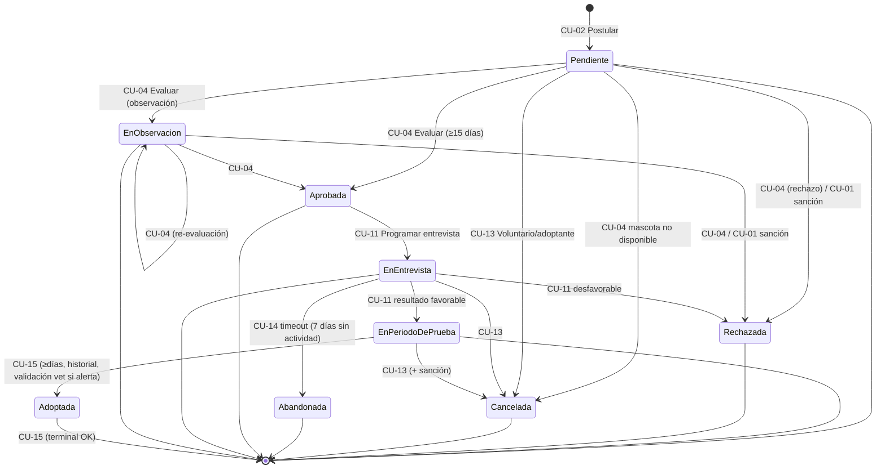
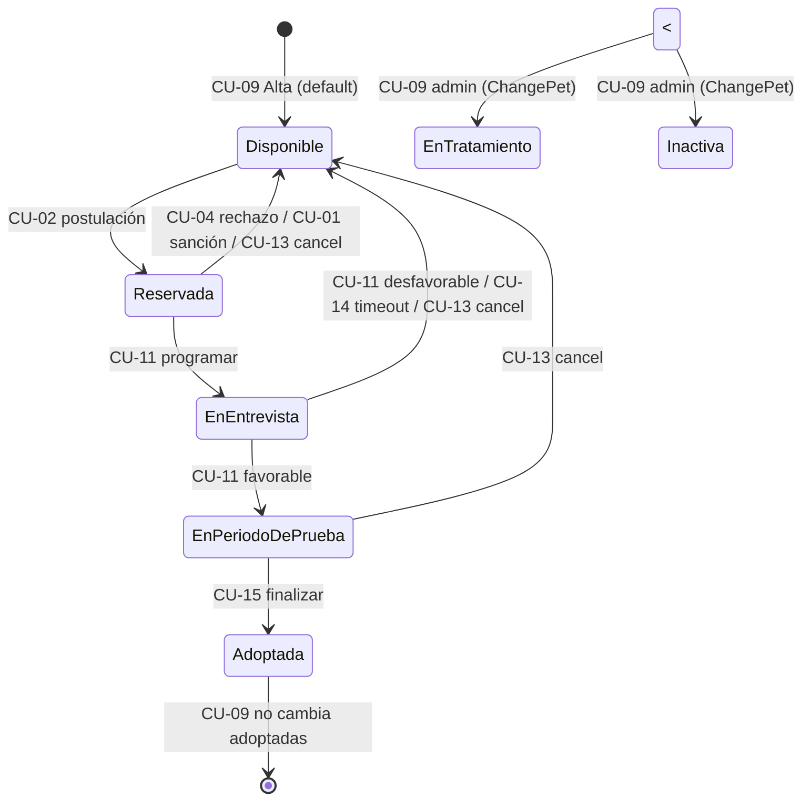
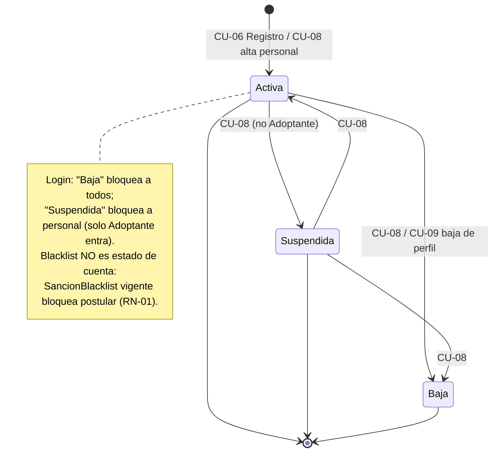

# Diagrama de flujo de estados — Portal de Adopción

> P3 del `Pendientes-Alta-Prioridad.md`. Fuente: transiciones válidas del código real
> (`BusinessLogic/Services/PortalService.cs`) y `Modelo-de-Estados-y-Reglas-de-Negocio.md`.
> Generado el 08/10/2026. Existe una versión PlantUML en `Diagrama-de-Estados.puml`.

Tres máquinas de estado relacionadas: **proceso (solicitud)**, **mascota** y **cuenta**.
Un proceso siempre arrastra el estado de su mascota (transiciones coloreadas).

---

## A. Proceso de adopción (`EstadoSolicitudEnum`)

Estados: `Pendiente · EnObservacion · Aprobada · EnEntrevista · EnPeriodoDePrueba · Adoptada`
(activos) y terminales `Rechazada · Cancelada · Abandonada`.

Reglas: `Activa(e)` = Pendiente | EnObservacion | Aprobada | EnEntrevista | EnPeriodoDePrueba.
No hay estados "devueltos" a activos desde terminales (irreversibles).

---

## B. Mascota (`EstadoMascotaEnum`)

Estados: `Disponible · Reservada · EnEntrevista · EnPeriodoDePrueba · Adoptada · EnTratamiento · Inactiva`.

---

## C. Cuenta de usuario (`Usuario.Estado`, string)

Estados: `Activa · Suspendida · Baja` (soft-delete). Roles: Adoptante/Voluntario/Veterinario/Administrador.

---

## Tabla de transiciones (fuente: `PortalService.cs`)

| CU | Método | De (solicitud) | A | Efecto mascota |
| --- | --- | --- | --- | --- |
| CU-02 | PostulateAsync | — | Pendiente | Disponible → Reservada |
| CU-04 | EvaluateAsync | Pendiente/EnObservacion | Aprobada (≥15 días) / EnObservacion / Rechazada | Rechazada → Disponible |
| CU-04 | EvaluateAsync (auto) | Pendiente/EnObservacion | Rechazada (sanción) / Cancelada (no disponible) | → Disponible |
| CU-01 | SaveBlacklistAsync | Activa | Rechazada | → Disponible |
| CU-11 | ScheduleAsync | Aprobada | EnEntrevista | Reservada → EnEntrevista |
| CU-11 | InterviewResultAsync | EnEntrevista | EnPeriodoDePrueba (favorable) / Rechazada | → EnPeriodoDePrueba / Disponible |
| CU-14 | AbandonAsync | EnEntrevista (idle > 7 días) | Abandonada | → Disponible |
| CU-13 | CancelAsync | Pendiente..EnPeriodoDePrueba | Cancelada (+ sanción si en prueba) | → Disponible |
| CU-15 | FinalizeAsync | EnPeriodoDePrueba | Adoptada | EnPeriodoDePrueba → Adoptada |
| CU-09 | ChangePetAsync | n/a | Disponible/EnTratamiento/Inactiva (admin) | Adoptada bloqueada |
| CU-08 | ChangeUserAsync | Activa/Suspendida | Suspendida/Baja | — |

Invariantes de acompañamiento: unicidad historial por mascota (CU-03/10), una única solicitud activa por mascota/adoptante (RN-04), mínimo 1 seguimiento diario (CU-12), responsabilidad del último administrador (CU-08), historial requerido antes de finalizar (CU-15).